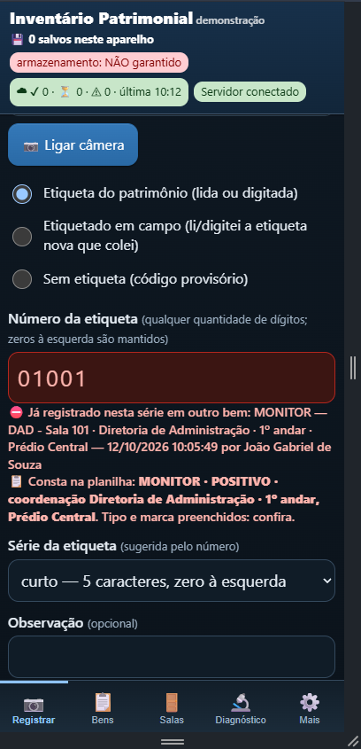
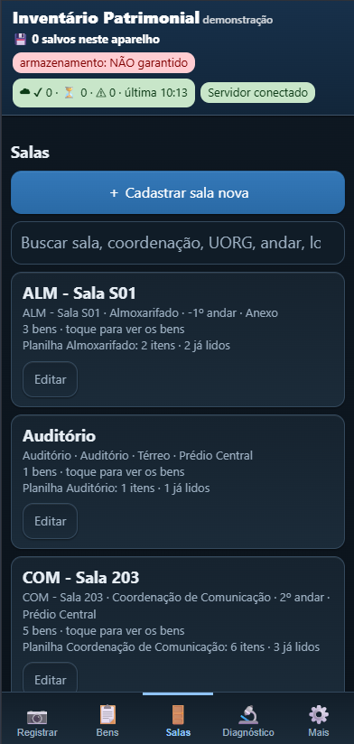
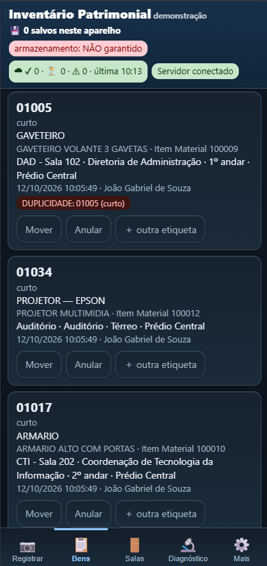
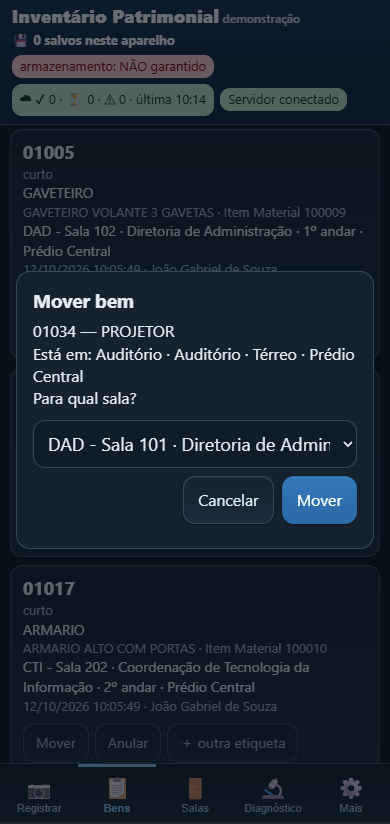
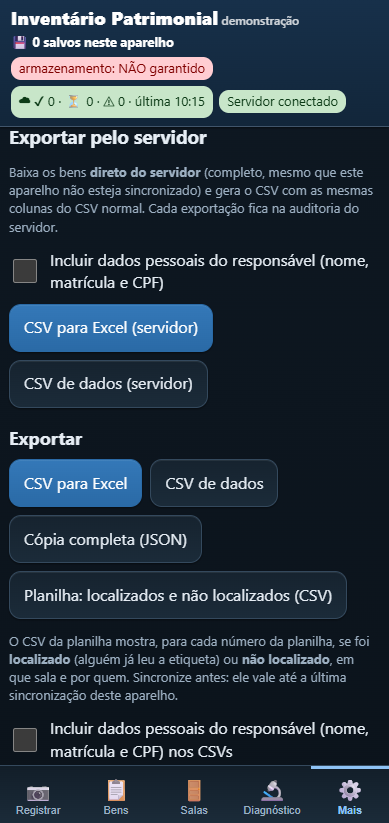
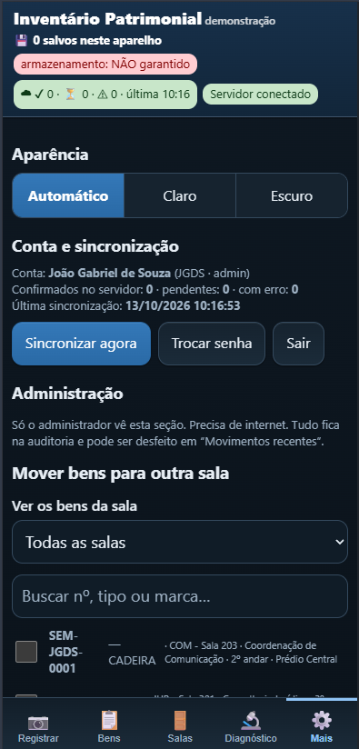
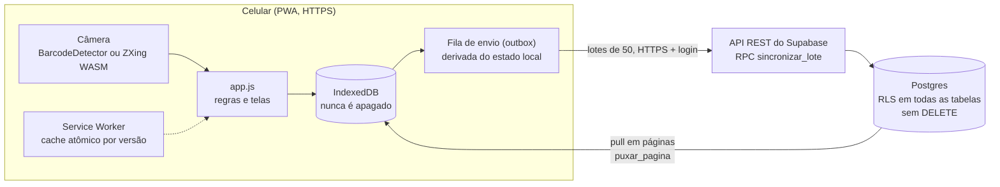

# Inventário Patrimonial (demonstração)

> **English summary.** Offline-first PWA for asset inventory ("patrimonial") taking, written in plain JavaScript (no framework,
> no build step). A phone camera reads barcode labels (native `BarcodeDetector` or ZXing-C++ compiled to WASM); every record is
> saved first to IndexedDB and a local-state-derived outbox syncs it to Supabase (Postgres + Row Level Security, no `DELETE`
> for anyone) through idempotent `security definer` functions. Includes a headless browser test suite and SQL RLS tests. All
> demo data is fictional ("Ministério Demo"). Documentation is in Brazilian Portuguese.

Aplicativo para celular (PWA) para fazer o **inventário de bens patrimoniais**: lê o código de barras da etiqueta pela câmera
(ou aceita o número digitado) e registra o bem na sala escolhida. Funciona **sem internet**: tudo é salvo primeiro no celular
e enviado ao servidor (Supabase) quando houver conexão.

**Demo publicada:** [inventario-patrimonial-pwa.vercel.app](https://inventario-patrimonial-pwa.vercel.app/). O cadastro está
desativado e o acesso exige login; as telas da seção "Telas" mostram o app com os dados de demonstração.

Este repositório é uma **versão de demonstração genérica** de um app real de campo. Todos os dados de exemplo são fictícios
(um "Ministério Demo"); nenhuma organização, pessoa ou patrimônio real aparece aqui.

## O problema que resolve

Fazer inventário patrimonial em prédios grandes tem três dificuldades:

1. **Sinal ruim** em salas, subsolos e garagens: o app não pode depender de internet para registrar.
2. **Várias pessoas coletando ao mesmo tempo**, cada uma com o seu celular, sem combinar o que cada um já leu: é preciso
   avisar de **duplicidade** sem travar o trabalho.
3. **Auditabilidade**: num inventário, apagar ou sobrescrever um registro é perigoso. Tudo precisa ficar rastreável.

## Funcionalidades

- Leitura da etiqueta pela câmera em vídeo contínuo, digitação manual e **modo diagnóstico** (mostra a simbologia e o
  conteúdo exatos lidos).
- **Salas** (com coordenação, UORG, andar, localidade e responsável), **tipo** e **descrição** do bem em listas com busca,
  marca e fornecedor.
- **Aviso de número repetido** na hora do registro, inclusive de bens registrados em outros celulares.
- **Trabalho offline**: fila de envio automática, contador de pendentes/confirmados/erros na faixa do topo.
- **Anulação em vez de exclusão**: "Desfazer meu último registro" marca o bem como anulado, com motivo.
- **Lista de consulta** (planilha de um inventário anterior): ao ler um número que consta nela, o app preenche tipo e marca e
  avisa; relatório CSV de "localizado / não localizado".
- **Catálogo legado**: consulta por plaqueta antiga, que preenche tipo, descrição e Item Material (a pessoa completa e salva).
- **Plaqueta de outro órgão** (letra `A` + dígitos): identificada, sem alerta de formato.
- **Mover bem** de sala; **administração** (mover em lote, mesclar salas, desfazer movimentos, gerenciar usuários, exportar
  pelo servidor).
- **Exportação**: CSV para Excel brasileiro (`;`, UTF-8 com BOM), CSV de dados e cópia completa em JSON.
- Tema claro, escuro ou automático; sem fontes nem scripts externos.

## Telas

| Registrar com leitura | Salas e resumo da planilha | Bens com aviso de duplicidade |
|---|---|---|
|  |  |  |

| Mover bem | Exportar CSV | Tema escuro |
|---|---|---|
|  |  |  |

*(Capturas feitas com o seed de demonstração; veja [docs/CAPTURAS.md](docs/CAPTURAS.md).)*

## Arquitetura



- `app.js`: banco local (IndexedDB), leitor, regras de etiqueta e duplicidade, telas, CSV/JSON.
- `sync.js`: motor de sincronização (fila, lotes, tentativas, pull, login/perfil/senha, faixa do topo).
- `remote-adapter.js`: contrato do backend e adaptador Supabase (REST via `fetch`, sem biblioteca). Trocar de backend =
  escrever outro adaptador.
- `sw.js`: instalação e uso offline. `vendor/`: leitor ZXing-C++ em WASM, local, para funcionar offline.
- `supabase/`: migrações 001 a 010, seed de demonstração e testes de permissão (RLS).

Detalhes em [docs/ARQUITETURA.md](docs/ARQUITETURA.md).

## Decisões técnicas e por quê

- **Offline-first com fila derivada do estado local.** O que precisa ser enviado é *calculado* a partir do que está salvo
  (sala, bem, etiqueta, anulação), não de uma lista paralela. Se o app fechar, a bateria acabar ou o celular reiniciar,
  nada se perde nem fica fora de sincronia. O bip só vem depois de a gravação ser confirmada em disco.
- **Ids gerados no celular (UUID).** O servidor grava com `on conflict (id) do nothing`: reenviar o mesmo lote não duplica e a
  fila pode ser reenviada sem medo, mesmo depois de falha de rede.
- **RLS e funções `security definer`.** Row Level Security em todas as tabelas, **ninguém tem `DELETE`** e os coletores nem
  gravam direto nas tabelas: toda escrita passa por `sincronizar_lote`, que valida o dono e calcula os campos. Perfil novo
  nasce inativo e só o administrador aprova; usuário desativado perde acesso a tudo.
- **Nunca apagar.** Desfazer é anular (com motivo e auditoria); mesclar salas não altera os bens; mover guarda o estado
  anterior para poder desfazer.
- **Leitura de código de barras com WASM.** O `BarcodeDetector` nativo é usado quando existe; senão, ZXing-C++ compilado para
  WASM (o iPhone não tem o nativo). Tudo local, sem CDN.
- **CSV seguro contra injeção de fórmula.** Texto livre (inclusive o que vem de um código de barras) é escapado e valores que
  começam com `=`, `+`, `-` ou `@` são neutralizados; `="..."` só é usado em números feitos só de dígitos, para o Excel não
  tirar o zero à esquerda.
- **CSP restrita.** O site só aceita scripts do próprio domínio (`'self'` + `wasm-unsafe-eval`) e conexões com
  `https://*.supabase.co`; por isso o app não tem script inline.
- **Sem `supabase-js`.** O adaptador fala direto com a API REST via `fetch`: menos código de terceiros.
- **Duplicidade avisa, não bloqueia.** O número não é único (há etiquetas de formatos diferentes e reetiquetagem); o app e o
  servidor sinalizam e mantêm os dois registros.
- **Atualização atômica do app.** Cada versão fica num cache próprio, é baixada por inteiro e espera o "Atualizar agora";
  nunca se serve HTML novo com JS velho.

Todas as decisões, com o contexto de cada uma, estão em [docs/DECISOES.md](docs/DECISOES.md).

## Testes

- **Suíte headless** ([tools/teste-headless.ps1](tools/teste-headless.ps1)): abre o app num Edge ou Chrome sem janela, semeia um
  banco no formato antigo (testa a migração) e confere salas, localidades, máscara de CPF, marca e fornecedor, descrições e
  busca, CSV (com e sem dados pessoais, **sem injeção de fórmula**), tema, faixa do topo, aviso de duplicidade com bem de
  outro aparelho, fila (`elegivel_sync`), tela de aprovação e de senha obrigatória, atualização atômica do service worker,
  CSP e cabeçalhos, pull paginado (retomada depois de queda, cursor só no fim), administração (mover, mesclar, usuários) e
  catálogo legado. Cada linha termina em `PASS` ou `FAIL`; o código de saída é 0 só se tudo passou.
- **Testes de permissão no banco** ([supabase/tests/rls.sql](supabase/tests/rls.sql)): rodam no SQL Editor e terminam em
  `ROLLBACK`. Verificam que anônimo não lê nada, que coletor não apaga nem grava direto, que reenviar o lote não duplica e
  que CPF e matrícula só o administrador lê.
- **Roteiro de campo** (modo avião, matar o app, reiniciar, 2.000 registros, vários celulares) em
  [docs/TESTES.md](docs/TESTES.md).

A suíte **não cobre** a sincronização real com o Supabase; para isso há os testes de RLS e o roteiro de campo.

## Segurança

- Chave **publishable** no app; a chave secreta nunca é usada (o app a recusa e o build do Vercel falha).
- RLS em todas as tabelas, sem `DELETE`, escrita só por funções que validam o dono, auditoria com o estado anterior.
- Sem cadastro aberto; senha provisória com troca obrigatória (mínimo de 10 caracteres); CPF e matrícula em tabela
  separada, só o administrador lê, e os celulares nunca os baixam.
- CSP, `X-Frame-Options`, `nosniff`, `Referrer-Policy` e `Permissions-Policy` (só câmera).
- Limite conhecido: o token de sessão fica no IndexedDB (veja [docs/LIMITACOES.md](docs/LIMITACOES.md)).
- `config.js`, `.env`, CSV, XLSX e dumps estão no `.gitignore`. **Nunca** versione dados reais.

## Como rodar localmente

Não há build. Sirva a pasta com qualquer servidor estático **em `localhost`** (a câmera só funciona em **HTTPS ou
`localhost`**):

```bash
python -m http.server 8080
```

Abra `http://localhost:8080`. Sem `config.js` o app funciona em **modo local** (sem servidor): tudo fica no IndexedDB do
navegador e a faixa do topo mostra "Modo local (sem servidor)". Para testar no celular, use um túnel HTTPS ou publique no
Vercel.

## Como configurar o Supabase

Passo a passo em [docs/CONFIGURACAO-SUPABASE.md](docs/CONFIGURACAO-SUPABASE.md): criar o projeto, desligar o cadastro aberto,
rodar as migrações 001 a 010 em ordem, criar o administrador, fazer o primeiro login, promover e rodar o
[seed de demonstração](supabase/seed_demo.sql). Depois copie `config.example.js` para `config.js` e preencha a URL e a chave
publishable.

## Como publicar no Vercel

1. Importe o repositório no Vercel (Framework Preset **Other**).
2. Em *Settings → Environment Variables*, crie `SUPABASE_URL` e `SUPABASE_PUBLISHABLE_KEY` (chave **publishable**).
3. O `vercel.json` roda `sh build.sh`: ele confere as variáveis (e **falha** se faltar uma, se a URL não for `https://` ou se a
   chave for secreta), carimba o SHA do commit no `sw.js` e gera o `config.js`.
4. Faça o deploy, abra o endereço no celular e instale na tela inicial. **Teste a câmera** depois de publicar.

A cada versão nova, troque `VERSION` em `sw.js` e em `app.js`.

## Glossário (termos herdados do domínio)

O app nasceu para um inventário na administração pública brasileira. Alguns termos ficaram nos rótulos e no CSV:

| Termo | Significado |
|---|---|
| **UORG** | Código da unidade organizacional (a "caixinha" do organograma) a que a sala ou o responsável pertence |
| **SIORG** | Código de registro da estrutura organizacional, usado para identificar a unidade do responsável |
| **Item Material** | Código numérico do item de material no catálogo de compras (liga a descrição ao tipo do bem) |
| **Coordenação** | Unidade administrativa dona da sala (aparece por sigla ou por nome completo) |
| **Catálogo legado** | Lista de consulta com bens de um sistema antigo, achados pela plaqueta antiga |
| **Plaqueta de outro órgão** | Etiqueta que começa com `A` + dígitos, emitida por outra organização |
| `legado_niveis_org` | Coluna do CSV com os níveis organizacionais herdados de dados antigos de sala |
| `uorg_sala`, `responsavel_*` | Colunas do CSV: UORG da sala e dados do responsável (nome, SIORG, UORG; matrícula e CPF só se marcados) |

**Nome histórico do esquema.** No banco existem `siads_bens`, `numero_siads`, `listar_siads_antigas` e `origem = 'siads'`.
É o nome **histórico** do esquema e equivale ao **catálogo legado**; foi mantido para não alterar tabelas, colunas e funções.
Na interface e nos documentos o termo é "catálogo legado". No CSV, a coluna correspondente é `numero_catalogo_legado`.

## Limitações conhecidas

- Sem XLSX (só CSV e JSON) e sem tela para resolver duplicidades (resolve-se por SQL).
- Sem recuperação de senha por e-mail: o administrador redefine no painel do Supabase.
- Um aparelho por pessoa; registro que nunca saiu do celular é perdido se o aparelho se perder antes de sincronizar.
- A suíte headless não cobre a sincronização real com o Supabase.
- Backup: script manual, sem workflow agendado neste repositório público ([docs/BACKUP.md](docs/BACKUP.md)).

Lista completa em [docs/LIMITACOES.md](docs/LIMITACOES.md).

## Próximos passos

Ideias, ainda não implementadas:

- Gerador de XLSX e tela de resolução de duplicidades.
- Tela de administração completa para tipos, descrições e localidades.
- Teste automatizado da sincronização contra um Supabase local (CLI) em CI.
- Conciliação por descrição entre o catálogo legado e os bens emplacados no levantamento.
- Rótulos configuráveis (para o glossário de domínio não ficar fixo no código).

## Desenvolvimento

Este projeto foi construído **com apoio de IA** (Claude Code, da Anthropic), que ajudou a escrever e revisar código, testes e
documentação. As **decisões de produto e de domínio**, o levantamento de requisitos, os **testes em campo** e a **operação**
do app real foram feitos por mim. Esta versão pública foi generalizada a partir desse app, com dados de demonstração
fictícios.

## Documentação

- [Arquitetura](docs/ARQUITETURA.md) · [Decisões](docs/DECISOES.md) · [Testes](docs/TESTES.md)
- [Configuração do Supabase](docs/CONFIGURACAO-SUPABASE.md) · [Backup](docs/BACKUP.md) · [Limitações](docs/LIMITACOES.md)
- [Capturas de tela e roteiro de vídeo](docs/CAPTURAS.md)

## Licença

[MIT](LICENSE) © 2026 João Gabriel de Souza
